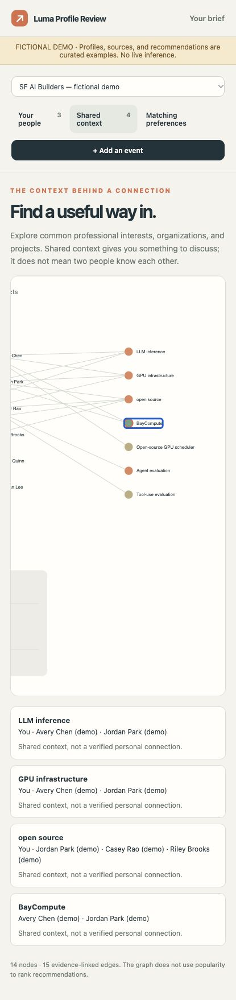

<div align="center">

# people for Luma

### Arrive prepared. Know who to meet.

Turn a crowded San Francisco event into a personal guide to your next good conversation.

[Explore the demo](https://people-for-luma.poggiolabmit.chatgpt.site) · [Get started](#your-first-guide) · [Setup help](docs/onboarding.md) · [Contribute](#build-with-us)

[](https://github.com/EmaRimoldi/luma-profile-review/actions/workflows/test.yml)
[MIT licensed](LICENSE) · Open source · Local app · Early alpha


<sub>Fictional sample profiles. The demo uses curated assessments, with no live model calls.</sub>

</div>

**Your interests → your criteria → your people.** Connect Luma and your agent;
your agent researches accessible professional profiles and explains whom to meet.
Research, progress, and results stay in the app.

## Your first guide

### 1. Launch the app

You need [uv](https://docs.astral.sh/uv/), a [supported agent or model](docs/backends.md),
and access to the event's Luma guest list. Choose Codex, Claude Code, Ollama,
or an explicit OpenAI/Anthropic API connection.

```sh
uvx --python 3.13 --from 'luma-profile-review[app] @ git+https://github.com/EmaRimoldi/luma-profile-review.git@main' luma-review serve --port 8765
```

Open **[localhost:8765](http://127.0.0.1:8765/)** and keep the terminal running.
This installs the public `main` branch; no source checkout is needed.
For the [0.4 review build](docs/service-audit.md), replace `@main` with
`@feature/agent-portability-audit`.

> **Just looking?** Choose **Explore the fictional demo** on the
> [website](https://people-for-luma.poggiolabmit.chatgpt.site).
> The complete agent workflow runs locally.

### 2. Connect once

Select **Connect Luma** on the welcome screen. Connect both accounts in the
panel, close it, then choose **Continue**.

<details>
<summary><strong>Sign-in & first-time setup</strong></summary>

| Connection | What to do |
| --- | --- |
| **Your agent** | Choose it in **Connections**. Codex supports **Sign in with ChatGPT**; Claude Code uses `claude auth login`. Ollama needs a running server and installed model. API modes need a model ID and key. |
| **Luma** | Choose **Connect Luma** in the panel. Sign in in the research browser it opens, return to the app, and select **Check Luma**. |

The first Luma connection downloads Chromium (roughly **300 MB**). The research
browser saves its own session: sign in there even if another browser is already
connected. **Check Luma** closes the sign-in window; research runs headlessly.

</details>

### 3. Give your guide a point of view

Answer five questions about your work, interests, goals, ideal connections,
and what you offer. Add optional **must-have criteria**, choose **Create profile**,
choose your backend, then **Find my people**.

<details>
<summary><strong>The five questions, with examples</strong></summary>

| The app asks | Example answer |
| --- | --- |
| **What are you working on?** | “I'm building an open-source inference tool.” |
| **What catches your curiosity?** | “GPU infrastructure, LLM serving, open source.” |
| **What would make the evening worthwhile?** | “Practical feedback and a potential collaborator.” |
| **Who would you love to meet?** | “Engineers running inference systems in production.” |
| **What can you bring to the conversation?** | “Benchmarking experience and thoughtful technical feedback.” |

A sentence per answer is enough. Your answers become an editable professional
profile and Markdown matching criteria. Update them through **Your profile**
or **Edit preferences**.

</details>

### 4. Bring the room into focus

Paste the Luma event URL → **Add event**. Choose a model and **10 profiles**
in the agent panel → **Prepare my guide**.

The agent collects accessible attendees, researches Luma, LinkedIn, and other
available professional sources, then loads reviewed cards and a context graph.
Follow progress in **Discover**; **Stop** keeps completed work.
Run another batch to explore more people.

### 5. Make your shortlist

Cards show professional context, an evidence-backed reason to connect when
available, and a conversation starter. Inspect **Conversation starter & sources**
for evidence and uncertainties.

| Action | What happens |
| --- | --- |
| **X / Skip** | Removes the person from your active stack. |
| **Save** | Keeps the person in **Saved** for another look. |
| **Meet** | Adds the person to your meeting list. No message is sent. |

Each choice reveals the next card; **Undo** reverses it. Search by name, company,
or interest, or switch to the scrolling list.

Explore shared interests, companies, and projects in **Context**.

<details>
<summary><strong>See the context graph</strong></summary>



Zoom, pan, and select nodes to inspect sources or return to a person's card.
Shared context alone does not establish that two people know each other.

</details>

<details>
<summary><strong>Missing context, partial lists & interrupted research</strong></summary>

**Needs context** means there is insufficient evidence to confirm a match, not
that someone is irrelevant. Review these profiles with that filter or **All reviewed**.

**Partial list** means roster coverage is incomplete. Some events limit guest
lists to registered attendees; signing in does not grant that access. Complete
required event steps yourself, then prepare another batch.

For sign-in or CAPTCHA interruptions, follow the app's instructions in the
research browser and resume. The agent does not register you or send invitations.

</details>

<details>
<summary><strong>Started on the website? Continue locally</strong></summary>

With your local app running on **8765**, choose **Prepare my guide → Continue
in desktop app** on the website, then **Use this profile & continue** locally.
Your answers and event transfer automatically. Research and results stay in the
local app and do not sync back to the website.

</details>

## Your data and your model

Collection works with every built-in backend; models receive professional excerpts.
Codex and Claude Code use their official CLIs; Ollama runs locally, and API modes
use explicitly supplied keys with separate billing.
Your workspace and browser session stay local; your professional brief and
analysis excerpts go to the selected model.

<details>
<summary><strong>Authentication, exports & other agents</strong></summary>

Codex's app-server handles authentication and subscription limits. The app never
reads credential files or silently switches to a paid API. Sources and choices
remain local; **Export guide** saves them as JSON or standalone HTML.

Public pages use HTTP and a local cache; dynamic or authenticated pages use
headless Chromium. MCP configurations support Codex, Claude Code, Cursor, VS Code,
Copilot CLI, Gemini CLI, OpenCode, Zed, and Claude Desktop.
See [model backends](docs/backends.md) and [agent integrations](docs/agents.md).

</details>

## Build with us

Try it at an event. [Tell us](https://github.com/EmaRimoldi/luma-profile-review/issues)
what helped, what was missing, or what slowed you down. Use fictional or redacted
examples in public issues.

<details>
<summary><strong>Run from source</strong></summary>

Python **3.11+** is required. The core has no Python dependencies; the `app`
extra adds Playwright, and `mcp` adds the official MCP Python SDK.

```sh
git clone --branch main https://github.com/EmaRimoldi/luma-profile-review.git
cd luma-profile-review
python3 -m venv .venv
.venv/bin/python -m pip install -e ".[app,mcp]"
.venv/bin/luma-review serve --workspace data/dev --port 8765
```

On Windows, use `.venv\Scripts\python.exe` and `.venv\Scripts\luma-review.exe`.
Linux may also need [Playwright system dependencies](https://playwright.dev/python/docs/browsers#install-system-dependencies).

For a local fictional demo, use a separate empty workspace:

```sh
.venv/bin/luma-review serve --workspace data/demo --demo --port 8766
```

Run the checks (Node.js is needed for JavaScript tests):

```sh
.venv/bin/python -m unittest discover -s tests -v
node --check src/luma_review/static/app.js
node --test tests/*.test.cjs
```

</details>

<details>
<summary><strong>Documentation & product decisions</strong></summary>

| Go deeper | Read |
| --- | --- |
| Setup, connections, and troubleshooting | [Complete onboarding](docs/onboarding.md) |
| Matching approach and alternatives | [Product decisions](docs/product.md) |
| Independent install, agent coverage, and efficiency measurements | [Service audit](docs/service-audit.md) |
| Earlier validation | [Validation record](docs/validation.md) |
| Source and model contracts | [Data formats](docs/data-format.md) |
| Related tools and launch scope | [Related projects](docs/related-projects.md) |

</details>

---

[MIT licensed](LICENSE). Independent project; not affiliated with Luma or LinkedIn.
Screenshots and public demo data are fictional. Bundled fonts and graph library
retain their [respective licenses](docs/third-party-assets.md).
