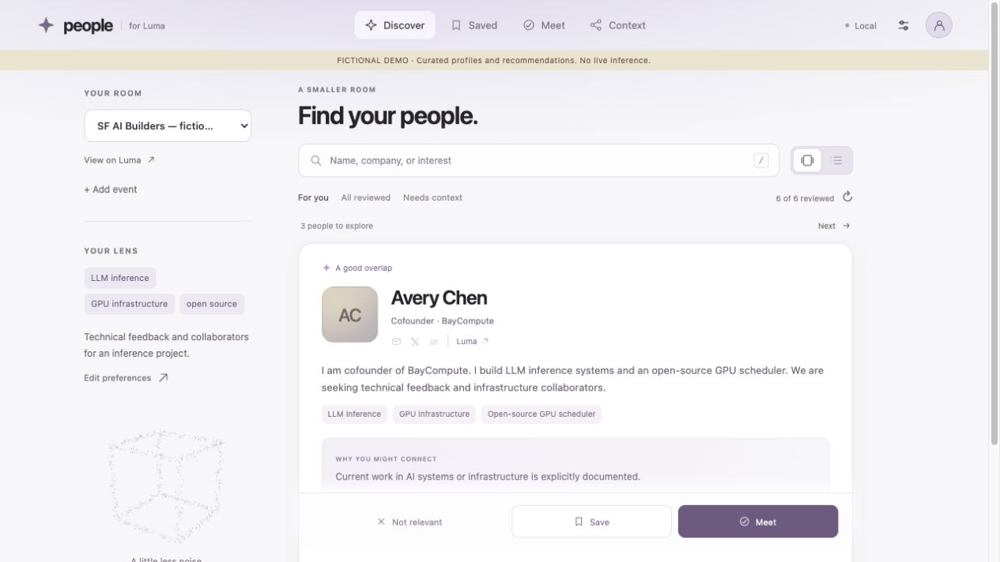

# Luma Profile Review

**Arrive prepared. Know who to meet.** Turn a crowded San Francisco event into a
personal guide to whom you could meet, why the connection could be useful,
and how to start the conversation.

An open-source, local application with a CLI, an MCP server, and a shared
agent skill. MIT licensed. Python 3.11+. The core has no Python dependencies;
the optional MCP integration uses the official Python SDK. The `[app]` extra
adds the managed research browser.



The discovery redesign adds a card stack, Skip / Save / Meet, undo,
local indexed search, sequential five-question setup, and model connections.
See [design and implementation decisions](docs/redesign.md).

Start with [People for Luma](https://people-for-luma.poggiolabmit.chatgpt.site), or
launch the complete local app. **Connect Codex → Connect Luma → Prepare guide**:
the agent works inside the platform, with live progress, Stop, and automatic
results. There is no task copying or chat handoff. The public site carries your
profile and event directly into the running local app. [Complete onboarding](docs/onboarding.md).

```sh
uvx --python 3.13 --from 'luma-profile-review[app] @ git+https://github.com/EmaRimoldi/luma-profile-review.git@feature/personal-event-guide' luma-review serve --port 8765
```

## The experience

1. **Write your brief.** Five short questions cover your work, interests,
   goals, the people you hope to meet, and what you can offer. They produce
   an editable professional profile and Markdown matching criteria. Only
   requirements you explicitly specify become hard filters.
2. **Bring an event.** Add its Luma URL. The built-in Codex agent
   collects the accessible guest list in resumable batches, deduplicating
   people by their profile URLs.
3. **Read relevant sources.** The app’s agent follows Luma profiles and linked
   LinkedIn, company, GitHub, and personal pages when useful. Read excerpts,
   source URLs, access dates, and access limitations are recorded separately
   from links that have merely been discovered.
4. **Prepare your conversations.** Source-grounded professional facts feed
   a personalized guide: reasons to meet, information to verify, useful
   conversation starters, and source citations. Save people, make a private plan to meet, record that you have met, or
   mark a suggestion irrelevant. Each decision advances the stack and can be undone.
5. **Explore shared context.** A graph connects people to documented
   interests, organizations, and projects. Shared company or topic never
   automatically becomes a claim that two people know one another.

The current release is an alpha. Authenticated collection is orchestrated by
the built-in research browser when you use the `[app]` extra. Access restrictions
and manual authentication remain visible; collection does not bypass them.

## Start locally

With [uv](https://docs.astral.sh/uv/), one command runs the current review branch
in an isolated environment (no manual virtualenv or Node installation):

```sh
uvx --python 3.13 --from 'luma-profile-review[app] @ git+https://github.com/EmaRimoldi/luma-profile-review.git@feature/personal-event-guide' luma-review serve --workspace ~/.luma-profile-review
```

Or from a checkout:

```sh
python3 -m venv .venv
.venv/bin/python -m pip install -e ".[app,mcp]"
.venv/bin/luma-review serve --workspace data/my-workspace
```

Open the printed loopback URL, connect Luma in the app’s research browser, and
answer the five questions. Choose your model connection during setup. The app and
agent integration share this workspace. Model requests use the selected
backend; no remote application account or hosted database is needed.

For a fictional walkthrough with no model requests:

```sh
.venv/bin/luma-review serve --workspace data/demo-workspace --demo
```

Use an empty workspace for the demo. Its profiles, sources, and assessments
are explicitly labeled fictional curated fixtures. It does not demonstrate
model quality or claim to contain actual event participants.

To use the CLI without installation, replace `luma-review` with
`python3 run.py`. MCP commands still need the optional MCP dependency in that
same interpreter.

## Advanced: connect an external agent

The primary integration targets are **Codex, Claude Code, Cursor, GitHub
Copilot in VS Code, and OpenCode**. Claude Desktop configuration is also
available. This is a compatibility and product-priority list, not a market-share
ranking. A shared MCP server avoids building a separate product for every host.

Generate copyable configuration for your agent:

```sh
.venv/bin/luma-review integration --agent codex --workspace data/my-workspace
.venv/bin/luma-review integration --agent claude --workspace data/my-workspace
.venv/bin/luma-review integration --agent cursor --workspace data/my-workspace
```

Also supported: `copilot`, `opencode`, `claude-desktop`. Add the printed
configuration in the indicated client location. Existing configuration is not
modified automatically. Keep the virtual environment interpreter in the
configuration so it can load the MCP dependency.

The shared skill is in [.agents/skills/luma-profile-review/SKILL.md](.agents/skills/luma-profile-review/SKILL.md),
with a thin Claude Code entrypoint under `.claude/skills/`. The MCP server
provides 11 tools for onboarding, event capture, research queues, structured
inference, matching, guides, and feedback.

An example task for your connected agent:

> Use Luma Profile Review. Ask me the short onboarding questions if my brief
> is missing. Collect the accessible profiles for this Luma event, enrich
> them with relevant professional sources using your browser, and prepare
> my personal guide using your current model. Show why each suggestion is
> useful, its sources, and what could not be verified.

For setup details, source collection, and current verification limits, see
[agent integrations](docs/agents.md). The project does not bundle a browser
driver or transfer your authenticated browser cookies to a model subprocess.

## Model choice and subscriptions

| Mode | How inference runs |
| --- | --- |
| Current agent | MCP `inference_tasks` and `submit_inference`; uses the model in your existing agent session |
| `codex` | Official `codex exec` with saved CLI login, structured output, and a read-only sandbox |
| `claude` | Official Claude Code CLI with saved login and structured output |
| `ollama` | JSON-schema chat with an explicitly selected installed local model |
| `openai` / `anthropic` | Explicit, separately billed API mode with a model ID and your API key |

The official CLIs manage their own authentication and normal account limits.
The tool does not extract OAuth tokens or silently fall back to paid APIs.
API keys entered in Connections stay only in server memory until restart.
`OPENAI_API_KEY` / `ANTHROPIC_API_KEY` also work for CLI and MCP API mode.
Existing environment credentials can affect which account a CLI uses. Run
`luma-review doctor` to check availability. See [backend details](docs/backends.md).

Source excerpts and your professional brief are sent to a selected cloud
model. Ollama defaults to a local loopback endpoint. All workspace data,
feedback, caches, and reports are local files, excluded from Git by default.

## Matching is an experiment

The initial guide uses source-grounded, per-criterion evaluation with
editable required conditions and weighted preferences. This is a replaceable
starting point, not a claim that this algorithm is optimal.

A literal keyword baseline is implemented for comparison. A local BM25 index
powers name, company, and topic search without model calls; it does not replace
the evidence-based default matching order. The graph explains
professional context; popularity is not used as a relevance score. Embedding
retrieval, pairwise reranking, and reciprocal matching are considered in
[the product and matching decision](docs/product.md), with promotion gates
based on user judgments rather than synthetic demo scores.

Similar projects already exist. See [related projects and launch scope](docs/related-projects.md)
for the overlap, our proposed focus, and what remains before a broader launch.

```sh
luma-review compare --workspace data/my-workspace --event EVENT_ID --labels data/relevance.json --k 10
```

Labels are a JSON object from canonical profile URL to `true` or `false`.
The comparison reports precision, judged coverage, and recall over the labeled
sample. Unjudged people are not treated as negative examples.

Exact-quote validation establishes traceability, not source truth or logical
sufficiency. Missing information produces `unknown`, not `no`. Proposed
professional value does not imply willingness to meet, buy, invest, or collaborate.

## CLI workflow and portable guides

```sh
luma-review onboard --workspace data/my-workspace
luma-review event --workspace data/my-workspace --url https://luma.com/EVENT --name "My event"
luma-review analyze --workspace data/my-workspace --event EVENT_ID --backend codex
luma-review guide --workspace data/my-workspace --event EVENT_ID --out data/my-guide.html
```

Swap `codex` for `claude`, or select `ollama --model YOUR_INSTALLED_MODEL`.
The exported HTML contains its code and data and is read-only: search, filters,
evidence, and the graph work without a running server. Remote profile photos
and outbound source pages need a network connection. Avoid sharing real event guides
unless you intend to share their profile excerpts and professional brief.

For current-agent inference without MCP, use `tasks --stage structure`,
`submit --stage structure`, then the equivalent matching commands. Each
response batch is tied to a snapshot hash. Changed sources, briefs, criteria,
or structured profiles invalidate affected evaluations. Source collection
has a separate resumable queue.

The original snapshot CLI remains supported:

```sh
python3 run.py evaluate --criteria examples/criteria.md --profiles examples/profiles.json --backend host --responses examples/responses.json --output data/legacy-demo
```

See [data formats](docs/data-format.md) for the snapshot and model contracts.

## Development and verification

```sh
.venv/bin/python -m unittest discover -s tests -v
node --check src/luma_review/static/app.js
node --test tests/search.test.cjs
node scripts/benchmark-search.cjs
```

Tests cover onboarding, source queues, evidence validation, stale inputs,
identity, graph semantics, feedback, model adapters, local HTTP boundaries,
and an actual MCP stdio client/server exchange when the extra is installed.
CI installs the MCP extra and runs on Python 3.11 and 3.13. See
[the validation record](docs/validation.md) for live versus mocked checks.

The public examples and screenshots are fictional. Real event data belongs
under ignored `data/`; intermediates belong under ignored `work/`. No attendee
records, authentication tokens, browser profiles, or local configuration belong
in commits. The code is not affiliated with Luma or LinkedIn.
